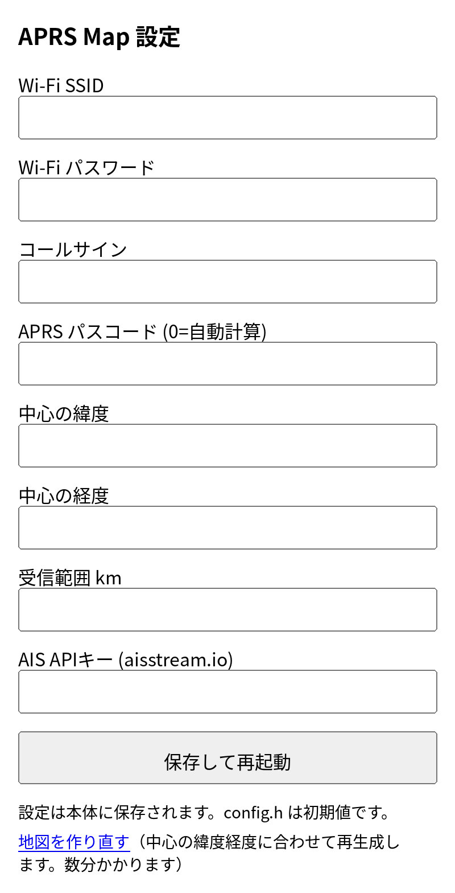

# APRSマップビューア（ESP32-2432S028・ILI9342パネル版）

ESP32-2432S028（2.8インチ CYD、抵抗膜タッチ）で動く、APRS・航空機・船舶のマップ表示機です。
本体だけで地図を自動生成する機能を備えています。

**この版は、パネルが ILI9342 の個体向けです。** 「ESP32-2432S028」は同じ型番でも搭載パネルや配線が異なる個体が流通しています（著者の手元でも、ILI9341 の個体と ILI9342 の個体がありました）。表示がおかしい場合は、下の「[CYD の種類と修正する箇所](#cyd-の種類と修正する箇所)」を見て、自分の個体に合わせて設定を直してください。

ファームウェア版数: **v81N**（スプラッシュ表示 "APRS Map Viewer 028 v81N" で確認できます）

## 画面

| 画面 | 地図 | 内容 |
|---|---|---|
| APRS | 設定中心の周辺（狭域） | APRS-IS から受信した APRS 局（APRS-IS: rotate.aprs2.net） |
| FLIGHT | 設定中心の周辺（広域） | ADS-B 航空機（adsb.lol、60秒ごとに取得） |
| AIS | FLIGHT と同じ地図 | AIS 船舶（aisstream.io、APIキーが必要） |

地図は本体内蔵＋本体生成のため、SDカードは不要です。

## 特徴

- **地図の自動生成**: 地図が無い状態で起動すると、国土地理院の地理院タイルを本体がダウンロードし、海岸線・境界を分類して 640×480 の白地図を生成、専用フラッシュ領域に保存します。生成には約1.5時間かかります（電源を切ると最初からやり直し）。生成できない・失敗した場合は内蔵の高松周辺地図で表示します
- **中心を変えただけでは作り直しません**: 保存済みの地図はそのまま使われます。作り直したいときは、ポータルの「地図を作り直す」から手動で実行してください
- 生成した地図にはヘッダのバックアップコピーが付き、電源再投入で読み取れなくなっても自動復旧します。生成・有効化に失敗した場合は、理由が次回起動時の MAP DIAG 画面に表示されます
- 初期設定はスマホから（セットアップ用AP「APRSMap-Setup」→ ブラウザのフォーム）。設定は本体の NVS に保存され、`config.h` は初期値（種）です
- 受信した局は電源を切っても保持され、次回起動時に復元されます
- 画面のちらつき対策として、変化のないマーカーの再描画をスキップします

## タッチ操作

| 操作 | 動作 |
|---|---|
| 上部バーのタブ | APRS / FLIGHT / AIS 画面の切り替え |
| 局・航空機・船をタップ | その対象を中央に表示してズームイン |
| 選択中の対象をもう一度タップ | 詳細表示（もう一度タップで閉じる） |
| 画面の端をタップ | その方向へ地図をスクロール（パン） |
| LIST ボタン | 受信中の一覧を開く。一覧の行をタップすると中央表示＋詳細 |

ズームは APRS 画面が ×0.5〜×3.5 の7段階、FLIGHT / AIS 画面が ×0.5 / ×1 / ×2 / ×4 です。

### 設定リセット

電源を入れてスプラッシュが表示された直後に **BOOT（GPIO0）を2秒長押し**すると、保存済み設定を消去してセットアップモードで起動します。

## CYD の種類と修正する箇所

CYD（Cheap Yellow Display）と呼ばれる ESP32＋TFT 基板は、同じ「ESP32-2432S028」の型番でも、メーカーやロットによって次の点が違う個体があります。表示やタッチがおかしい場合は、この順に確認してください。修正は主に `include/LGFX_028.h`（パネル設定）と `src/main.cpp` の数行です。

### 1. パネルコントローラの種類

`include/LGFX_028.h` のパネルクラスと寸法が、搭載コントローラと一致している必要があります。

| コントローラ | パネルクラス | panel_width × panel_height / memory_width × memory_height |
|---|---|---|
| ILI9341 | `lgfx::Panel_ILI9341` | 240 × 320（縦が原生） |
| ILI9342 | `lgfx::Panel_ILI9342` | 320 × 240（横が原生） |
| ST7789 | `lgfx::Panel_ST7789` | 240 × 320（縦が原生） |

この版は **ILI9342** 用の設定です。コントローラが違うと、文字が鏡像になる・縦横が合わない・画面の一部が描画されない（帯が残る）といった症状が出ます。パネル裏面の型番シールや、購入時の仕様で確認してください（ソフトからの ID 読み取りは、SDO 未配線の個体ではできません）。

### 2. 画面の回転（鏡像・縦横がおかしい場合）

`include/LGFX_028.h` の `cfg.offset_rotation` と、`src/main.cpp` の `setup()` 内 `tft.setRotation(2)` の組み合わせで決まります。文字が普通に読めて横長に表示される組み合わせが正解です。この版は offset_rotation = 0 ＋ setRotation(2) です。鏡像になる場合は、回転値を 0〜7 の範囲で変えて試してください（4〜7 は反転系の回転です）。

### 3. 色の反転（白が黒に出る・色全体が写真のネガのようになる場合）

`include/LGFX_028.h` の `cfg.invert` を切り替えます。この版（ILI9342）は **true（反転ON）** です。ILI9341 の個体では false が多いようです。

### 4. 色順と、pushImage だけ色がずれる現象

地図のように `pushImage` で描く部分だけ色が回って見える個体があります（`fillRect` の色は正常）。同じ色を fill と push で並べて描き、見え方で判断します。

| push の見え方 | 対処 |
|---|---|
| fill と一致する | パレットは標準の RGB565 詰め `(r << 8) \| (g << 3) \| (b >> 3)` 相当にする |
| 赤↔青だけ入れ替わる | `cfg.rgb_order = true`（BGR）にするか、パレットを BGR 詰めにする |
| 赤→青、緑→赤、青→緑 と巡回する | この版の方法：パレットを (b, r, g) の順に詰めて先行補正する |

この版では巡回タイプだったため、`src/main.cpp` の `initInkPal()` で地図パレットを先行補正しています（コメント `pre-rotated` の2行）。自分の個体が別タイプだった場合は、この2行の詰め方を上の表に合わせて直してください。

### 5. バックライトが点かない場合

`include/LGFX_028.h` の Light 設定 `cfg.pin_bl` です。2432S028 系は GPIO21 が多いですが、2432S024 系などは GPIO27 です。

### 6. タッチの配線（タッチが全く効かない場合）

タッチ用 SPI の配線が2通りあります。`src/main.cpp` の `touchRoute()` と `setup()` 内の `touchSPI.begin(...)` の引数（CLK, MISO, MOSI, CS）を合わせてください。

| 配線 | begin の引数 |
|---|---|
| 専用バス（この版） | `touchSPI.begin(25, 39, 32, 33)` |
| 表示バスと共有 | `touchSPI.begin(14, 12, 13, 33)` |

### 7. タッチの向き（タッチ位置がずれる・反転する場合）

`src/main.cpp` の `touchLoop()` 内の変換2行と、`setup()` 内の `ts.setRotation(1)` で調整します。

```cpp
int x = constrain(map(p.x, 200, 3700, 0, 319), 0, 319);
int y = constrain(map(p.y, 240, 3800, 0, 239), 0, 239);
```

- 左右が逆 → X の変換を `map(p.x, 200, 3700, 319, 0)` のように逆向きにする
- 上下が逆 → Y の変換を逆向きにする
- 縦横が入れ替わる → `ts.setRotation(...)` の値を変える（0〜3）

### 著者が確認した2つの「2432S028」個体の設定

| 項目 | 旧個体 | この版の個体 |
|---|---|---|
| パネル | ILI9341 | ILI9342 |
| invert | false | **true** |
| offset_rotation / setRotation | 1 / 2 | 0 / 2 |
| パレット先行補正 (b, r, g) | あり | あり |
| バックライト | GPIO21 | GPIO21 |
| タッチバス | 専用 (25/39/32/33) | 専用 (25/39/32/33) |

なお、ESP32-2432S024（バックライト GPIO27、タッチは表示バス共有、色順 BGR）向けの版は別リポジトリで公開しています。

## ビルドと書き込み

PlatformIO プロジェクトです。

1. このフォルダを PlatformIO（VS Code）で開く
2. そのまま Upload

依存ライブラリ（LovyanGFX、XPT2046_Touchscreen）は `platformio.ini` の `lib_deps` で自動取得されます。PNG 解読用の pngle / miniz は `src/pngle/` に同梱しています。

パーティションは `partitions_mapgen.csv`（4MB フラッシュ用：アプリ 0x1D0000 ＋ 地図保存領域 mapdata 0x210000）を使います。

> **注意:** パーティション構成が標準と異なるため、旧構成のファームから初めて書き込む場合は合体イメージを 0x0 から書く等でパーティションテーブルごと更新してください。その際、本体の設定（Wi-Fi・コールサイン・AISキー・保存済みの局）は消えます。通常の PlatformIO アップロード（アプリのみ更新）では消えません。

## 設定項目（スマホのフォーム）

Wi-Fi SSID / パスワード、コールサイン、APRS パスコード（0 = 自動計算）、中心の緯度・経度、受信範囲 km、AIS APIキー（aisstream.io の無料キー）。
接続中は http://aprs-map.local からも変更できます。

設定画面（未入力の状態）:

![設定画面]

## 地図データについて

内蔵地図データ（`include/maps_data.h`）および本体内で生成される地図は、国土地理院の地理院タイルをもとに作成した白地図データ（海岸線・境界）を加工したものです。
